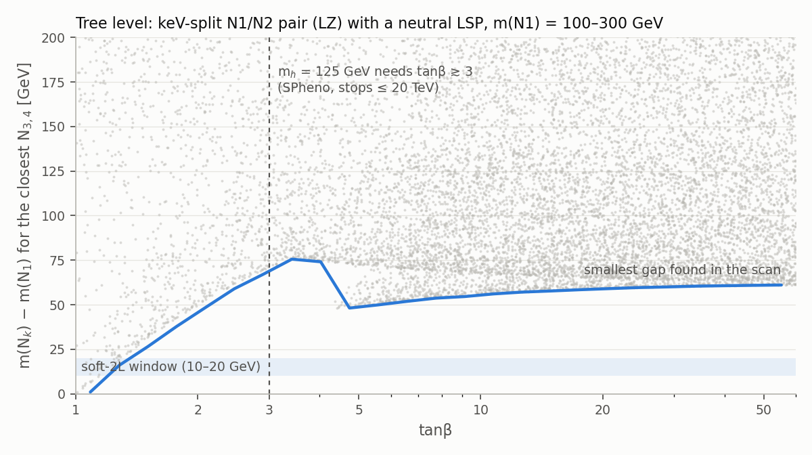

# LZ shenanigans

Can a pMSSM spectrum explain three mild excesses at once?

| Excess | Size | Paper |
|---|---|---|
| LZ: one nuclear recoil at 248 ± 23 ± 23 keV | 2.6σ global, 3.4σ local | [arXiv:2609.02823](https://arxiv.org/pdf/2609.02823) |
| ATLAS soft 2ℓ: m_ℓℓ < 20 GeV, 383 vs 301 ± 23 | 2.7σ local | [SUSY-2018-16](https://atlas.web.cern.ch/Atlas/GROUPS/PHYSICS/PAPERS/SUSY-2018-16/index.php) |
| ATLAS compressed sleptons: μ̃ at Δm ≈ 3–10 GeV, ẽ at Δm ≈ 30–50 GeV | 2.4σ / 2.0σ local | [HMBS-2024-64](https://atlas.web.cern.ch/Atlas/GROUPS/PHYSICS/PAPERS/HMBS-2024-64/) |

Spectra are computed with the [Run3ModelGen](Run3ModelGen) submodule (SPheno, micrOMEGAs 7.1.10, SModelS 3.2.1).

## Results

**No pMSSM configuration explains LZ and the soft-2L excess together with m_h = 125 GeV.**

- **LZ needs inelastic scattering, N1 N → N2 N, with m(N2) − m(N1) ≈ 100–250 keV.** Elastic scattering gives 0σ. With TeV gauginos, such a gap only occurs where the two Higgsino-like states cross. They have opposite CP, so they don't mix, and reaching the crossing means tuning one gaugino mass to about 10⁻⁶.
- **LZ alone works** for a nearly pure Higgsino with gauginos at 1–3.5 TeV and tanβ ≈ 5 (class F). Crossings with more gaugino mixing (B, C, E) are excluded by LZ's own elastic limit.
- **LZ + soft-2L** needs a third neutralino 10–20 GeV above the pair. That only happens at tanβ ≲ 1.3 with the wino near μ (class A), where m_h ≈ 102 GeV. Even then the soft-2L fit barely improves, because N3 decays mostly to C1 W* and N2 γ.
- **Soft-2L alone:** a compressed wino/bino at 200 GeV (D2) gives Δχ² = −4.0. The best fit wants 2.5× more signal, which is in tension with CMS-SUS-21-008 (r = 0.98).
- **Sleptons:** light right-handed sleptons can be added to class F without breaking anything. In pMSSM-19, though, ẽ and μ̃ are degenerate, while ATLAS saw each excess in one flavour only. The slepton search isn't in SModelS, so this match is kinematic only.



| Configuration | LZ | soft-2L | smuon | selectron | m_h = 125 |
|---|---|---|---|---|---|
| **A** wino–Higgsino crossing, tanβ ≈ 1.2 | ✓ | ≈0 | ✓ | – | ✗ (~102) |
| **B/C/E** Higgsino crossing with gaugino mixing, tanβ ≈ 10 | ✗ elastic SI | – | ✓ | ✓ (E) | ✓ |
| **F** nearly pure Higgsino crossing, TeV gauginos, tanβ ≈ 5 | ✓ | – | ✓ | ✓ (F3) | ✓ |
| **D1** compressed Higgsino, Δm = 15 GeV | – | – | ✗ | – | ✓ |
| **D2** compressed wino/bino, Δm = 15 GeV | – | ✓ (CMS tension) | ✓ | – | ✓ |

✓ fits or allowed · ≈0 signal predicted but no improvement · – no relevant signal · ✗ excluded

### Benchmarks

The SLHA files in [`benchmarks/`](benchmarks) include decays and 13 TeV cross sections. Each has a JSON summary with mixing, micrOMEGAs output and SModelS results.

| Benchmark | tanβ | m(N1) | N2−N1 | N3−N1 | C1−N1 | light μ̃ | m_h | Ωh² | SI/limit | 2ℓ Δχ² | r_max |
|---|---|---|---|---|---|---|---|---|---|---|---|
| [A](benchmarks/A_wino_higgsino_crossing.slha) | 1.23 | 252.5 | 163 keV | 17.5 | 4.5 | – | 102.8 | 0.005 | 0.8 | −0.0 | 0.36 |
| [A + smuons](benchmarks/A_wino_higgsino_crossing_smuons.slha) | 1.23 | 250.5 | 161 keV | 17.5 | 4.2 | R 256 | 102.9 | 0.006 | 2.2 | −0.0 | 0.37 |
| [A2](benchmarks/A2_light_wino_higgsino_crossing.slha) | 1.19 | 180.8 | 109 keV | 16.0 | 7.5 | – | 101.5 | 0.004 | 2.0 | −0.3 | 0.66 |
| [B](benchmarks/B_light_higgsino_crossing.slha) | 10.2 | 165.7 | 103 keV | 69.2 | 5.0 | – | 125.1 | 0.004 | 37 | −0.3 | 0.59 |
| [B + smuons](benchmarks/B_light_higgsino_crossing_smuons.slha) | 10.2 | 164.5 | 100 keV | 68.7 | 5.0 | R 170 | 125.0 | 0.005 | 40 | −0.3 | 0.61 |
| [C](benchmarks/C_heavy_higgsino_crossing.slha) | 10.4 | 562.7 | 232 keV | 119.6 | 2.0 | – | 125.0 | 0.033 | 20 | 0.0 | 0.05 |
| [E (selectrons)](benchmarks/E_higgsino_crossing_selectrons.slha) | 10.1 | 352.4 | 200 keV | 97.9 | 3.1 | R 387, L 397 | 124.9 | 0.014 | 17 | 0.0 | 0.10 |
| [F1](benchmarks/F1_pure_higgsino_crossing.slha) | 5.05 | 229.2 | 154 keV | 686.5 | 1.2 | – | 124.9 | 0.006 | 0.02 | −0.0 | 0.52 |
| [F1 + smuons](benchmarks/F1_pure_higgsino_crossing_smuons.slha) | 5.05 | 227.5 | 153 keV | 639.6 | 1.3 | R 233 | 125.1 | 0.007 | 0.02 | −0.0 | 0.54 |
| [F2](benchmarks/F2_pure_higgsino_crossing_heavy.slha) | 5.08 | 546.7 | 231 keV | 1063.7 | 0.8 | – | 125.0 | 0.030 | 0.01 | 0.0 | 0.02 |
| [F3 (selectrons)](benchmarks/F3_pure_higgsino_crossing_selectrons.slha) | 5.03 | 382.7 | 207 keV | 911.7 | 0.9 | R 423 | 125.0 | 0.015 | 0.01 | 0.0 | 0.08 |
| [D1](benchmarks/D1_compressed_higgsino.slha) | 10.0 | 207.7 | 14.9 GeV | 203.2 | 8.1 | – | 124.7 | 0.008 | 26 | +0.1 | 0.38 |
| [D1 + smuons](benchmarks/D1_compressed_higgsino_smuons.slha) | 10.0 | 207.5 | 15.0 GeV | 199.2 | 8.2 | R 213 | 124.6 | 0.013 | 51 | −0.0 | 1.09 |
| [D2](benchmarks/D2_compressed_wino_bino.slha) | 10.0 | 197.2 | 15.0 GeV | 819.3 | 15.1 | – | 125.1 | 0.042 | 1.5 | −4.0 | 0.98 |
| [D2 + smuons](benchmarks/D2_compressed_wino_bino_smuons.slha) | 10.0 | 194.8 | 15.0 GeV | 818.5 | 15.1 | R 201 | 125.0 | 0.053 | 2.5 | −0.2 | 0.27 |

Masses are in GeV. Column definitions:
- **SI/limit:** elastic SI × Ωh²/0.12 divided by the LZ 2024 limit, approximated as 2.2 × 10⁻⁴⁸ cm² × m/40 GeV.
- **2ℓ Δχ²:** −2 ln(L/L_SM) in the combined SUSY-2018-16 fit.
- **r_max:** the largest SModelS r.

## The excesses in brief

**LZ.**
- Only interactions that favour high-energy recoils fit; standard elastic SI gives 0σ.
- The paper notes that inelastic SI scattering "resembles a Higgsino model" (arXiv:2409.07768).
- Local significance for that interaction (Table S8), tested only at m ≥ 400 GeV: 0σ for δ ≤ 50 keV, 2.2σ at 150 keV, 2.6–2.7σ at 200 keV, 3.0–3.3σ at 300–350 keV.

What a Higgsino reading implies (my estimates):
- **Fixed coupling:** the coupling is set by the Z, not free. Whether it matches LZ's fitted interval is the key test, and it isn't done here.
- **Relic fraction:** below about 1.1 TeV a Higgsino is underabundant, so the LZ rate scales with Ωh²/0.12.
- **Velocity tail:** only the fastest dark matter can scatter. The largest reachable gap is about 270 keV at 200 GeV and 390 keV at 1 TeV.
- **N2 lifetime:** N2 decays as N2 → N1 γ with a lifetime of seconds.

**ATLAS soft 2ℓ (SUSY-2018-16, 139 fb⁻¹).**
- The paper itself reports no excess; the deviations are in Table 10 and in SModelS's exclusive bins:
  - μμ, high E_T^miss, m_ℓℓ = 10–20 GeV: 23 vs 14.6 ± 3.0;
  - ee, high E_T^miss, m_ℓℓ = 5–10 GeV: 16 vs 4.8 ± 1.6;
  - Higgsino SR-E-med: 170 vs 112 ± 13.
- Since m_ℓℓ ends at the mass gap, this points to Δm(N2, N1) ≈ 10–20 GeV (my reading).
- Limits: Higgsino N2 > 193 GeV at Δm = 9.3 GeV; wino/bino > 240 GeV at Δm = 7 GeV.

**ATLAS compressed sleptons (arXiv:2503.17186, 140 fb⁻¹).**
- **Smuons:** 23 vs 13.7 and 26 vs 13.7 in the Δm = 5–10 GeV regions; best fit (m_μ̃, m_N1) = (150, 140) GeV at 2.1σ.
- **Selectrons:** 7 vs 2.8 in the Δm = 40–50 GeV region; best fit (375, 335) GeV at 1.9σ.
- **The two don't match:** each best fit gives < 1σ in the other flavour.

## Method

1. **Tree-level scan** ([`treelevel_scan.py`](scan/treelevel_scan.py)): 400k samples of (tanβ, μ, one gaugino mass), solving for the other gaugino mass at every N1/N2 crossing. Requirements: m(N1) ≥ 100 GeV, a Z–N1–N2 coupling, and a neutral LSP. Candidates are in [`results/`](scan/results).
2. **Loop-level benchmarks** ([`benchmarks.py`](scan/benchmarks.py)):
   - A_t is tuned for m_h;
   - sleptons are placed at m(N1) + Δm;
   - M₁ or M₂ is root-found so that SPheno's loop-level N2 − N1 puts the 248 keV recoil at v_min = 650 km/s;
   - micrOMEGAs, gm2calc and SModelS then run on the result.
3. **Soft-2L fit** ([`soft2l_fit.py`](scan/soft2l_fit.py)): SModelS has no full likelihood for SUSY-2018-16, so all exclusive electroweakino, Higgsino and slepton bins are combined. Each bin is Poisson with its background uncertainty profiled, and bins are treated as uncorrelated.

**Caveats.**
- **LZ rate and spectrum** are not computed for any benchmark (that needs e.g. WimPyDD and a halo model).
- **Elastic SI limit** is a rough scaling.
- **Class A** has a large spin-dependent cross section that hasn't been checked.
- **Soft-2L fit:** it misses cascades through light sleptons, and treats charginos within 5 GeV of N1 as invisible.
- **Slepton benchmarks** need m_A = 1 TeV and split staus to get the right-handed smuon within 6 GeV of N1.

## Reproducing

```bash
git clone --recurse-submodules git@github.com:jwuerzinger/LZ_shenanigans.git
cd LZ_shenanigans/Run3ModelGen && pixi install && pixi run build
cd ../scan && ../Run3ModelGen/.pixi/envs/default/bin/python treelevel_scan.py 200000 && ../Run3ModelGen/.pixi/envs/default/bin/python plot_treelevel.py
cd ../Run3ModelGen
pixi run bash -c '. build/setup.sh && python ../scan/benchmarks.py && python ../scan/soft2l_fit.py ../benchmarks/*.slha'
cd ../scan && ../Run3ModelGen/.pixi/envs/default/bin/python summarize.py
```
